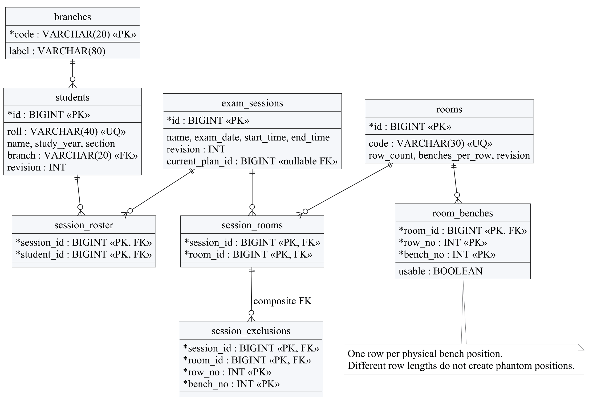
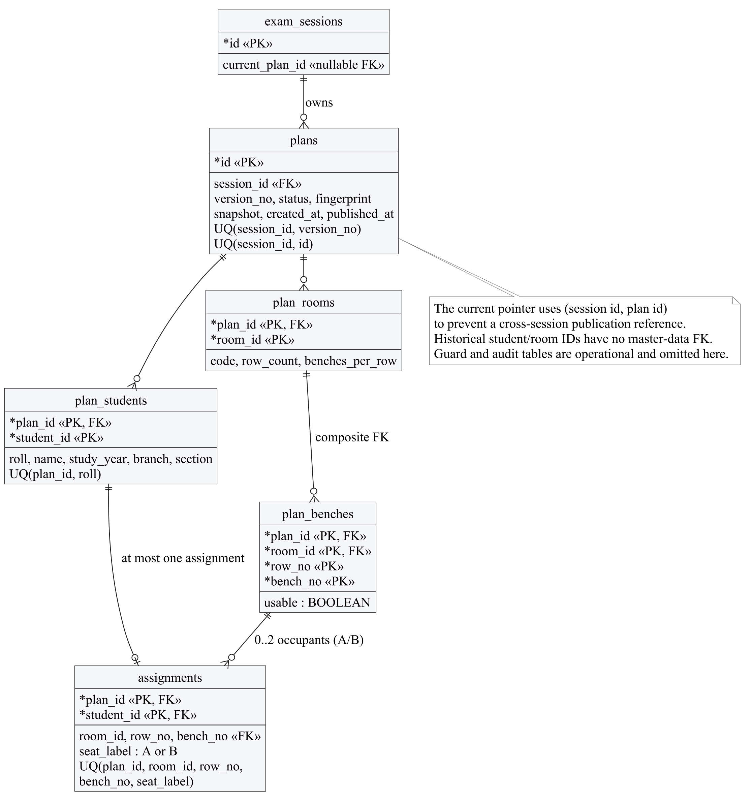
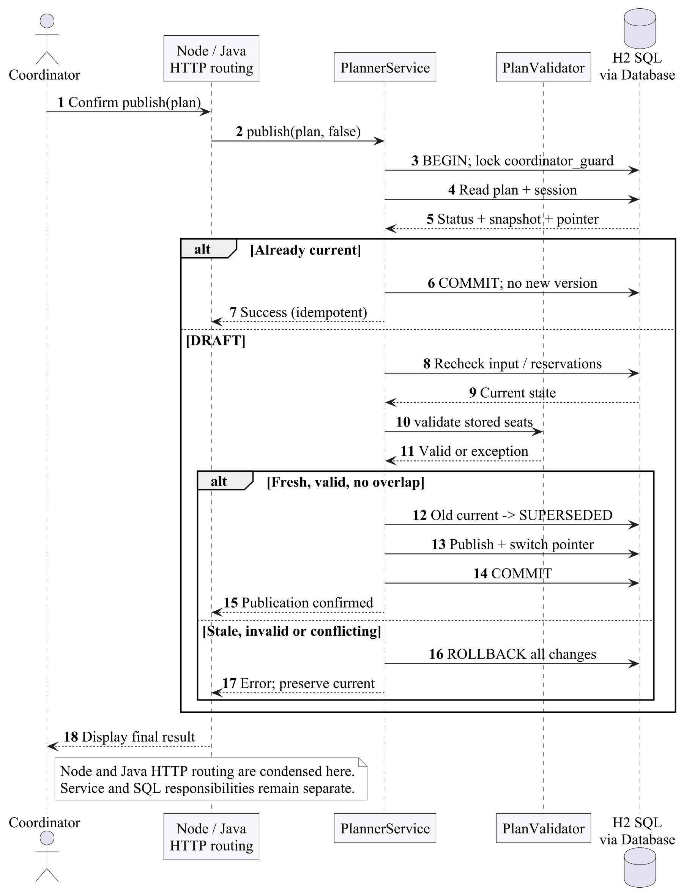
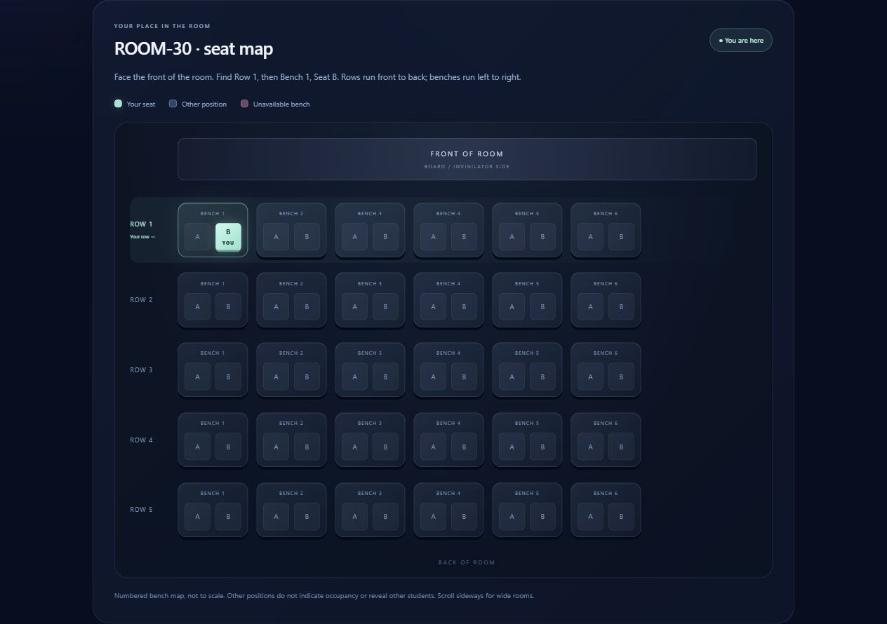
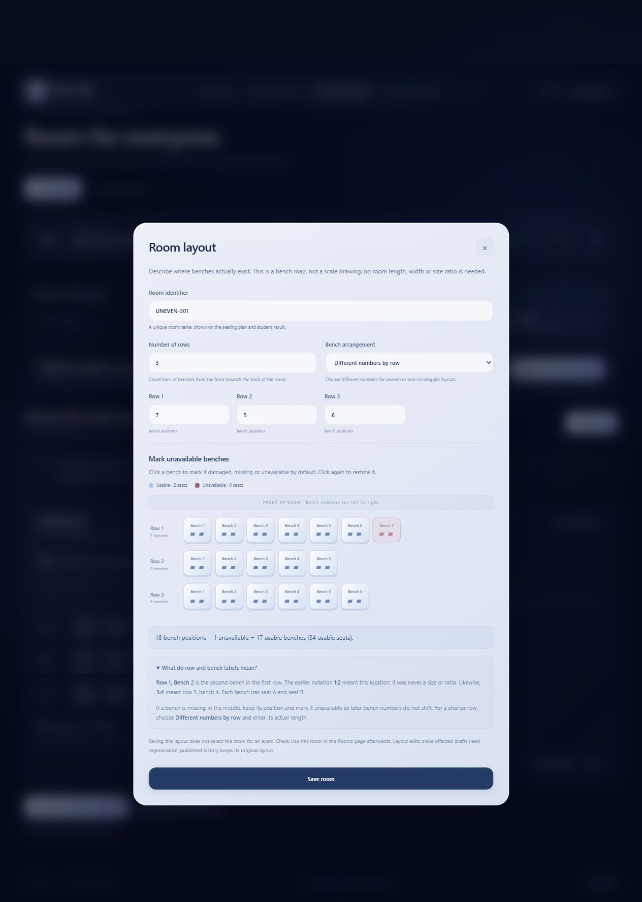

# Seyra Database Management Systems Report

A relational H2 database stores editable exam inputs and immutable plan snapshots. This report concentrates on keys, dependencies, normalization, queries, views, restricted SQL access, transactions, concurrency and executed routines and triggers.

## 1 INTRODUCTION

Seyra is a working exam hall seating planner. A coordinator saves an exam session, its student roster and the rooms available for that sitting. Java generates a private draft, checks every placement and publishes a reviewed version. Students look up their roll number and see the exact A or B seat highlighted in the published room layout.

The problem is more specific than placing names in a rectangular grid. Two students may share a bench only when their years differ or their branches differ. Different sections alone do not make a pair eligible. A room may have seven benches in one row and five in another. Missing or damaged positions must not silently reappear, and an edited roster must not change an already published historical plan.

The completed system uses Java 21 for business rules and JDBC, H2 for the tested SQL database, a Node.js HTTP server for pages and API forwarding, and plain HTML, CSS and JavaScript for the browser interface. The hosted Render service exposes a shared fictional demonstration. Its temporary database resets on restart; the local workspace stores its own records separately.

## 2 EXISTING SYSTEM

A manual spreadsheet approach asks the coordinator to compare student groups, calculate capacity, place names, check duplicates and distribute a final list. This is the reference workflow being improved, not a measured study of a particular college's existing software.

Counting empty seats alone is insufficient. Consider 30 second-year AI_ML students and 10 second-year CSE students. There are 40 students, but the first group needs 30 separate benches. Twenty-four benches provide 48 physical seats and still fall six benches short under the sharing rule. A spreadsheet that divides the roster by two can therefore approve an impossible arrangement.

Copying a spreadsheet after each edit also makes the current publication unclear. A student may receive an older copy while the coordinator has a newer draft. Room changes can erase the layout associated with a previous sitting. Seyra addresses these problems through explicit publication, immutable plan snapshots and a student view tied to one current version.

## 3 PROPOSED SYSTEM

The coordinator follows five visible stages: save the session time, choose the student roster, select and configure rooms, generate and review a draft, then publish it. The interface explains what is missing before the next action. Unsaved form changes must be saved before generation so that the draft corresponds to stored inputs.

Each usable bench has positions A and B. The room editor accepts the actual bench count for every row; for example, 7, 5, 6 means three rows with those respective counts. It is not a 7:5:6 scale or screen aspect ratio. Whole benches can be excluded by room default or for a particular session. The map preserves their coordinates so a later bench is not renumbered into a damaged position.

The allocator groups students by year and branch, pairs eligible groups and allows single occupancy. A separate validator checks the resulting placements. Generated plans remain DRAFT until the coordinator explicitly publishes them. Publication checks current inputs and room conflicts again, then replaces the previous publication atomically. Students receive only the current published assignment and their assigned room geometry.

The scope is a small coordinator-managed examination workflow. The current rule concerns bench sharing; it does not promise separation between adjacent benches, optimal walking distance, accessible-seat placement or invigilation staffing. Those would require additional requirements and a different feasibility model.

## 4 HARDWARE AND SOFTWARE REQUIREMENTS

### Software used

| Component | Tested configuration | Purpose |
| --- | --- | --- |
| Java | Temurin JDK 21.0.13+9 | HTTP API, allocation, validation, JDBC and optional Swing client |
| Node.js | 24.20.0; project engine accepts 20 or later | Static pages, API proxy and development scripts |
| Database | H2 2.4.240 | File persistence, SQL constraints, views and transactions |
| JSON | Jackson 2.18.3 | Java request and snapshot serialization |
| Browser | Chrome on Windows | Coordinator, student and print-preview checks |
| Hosting | Render free Docker web service | Fictional shared HTTPS demonstration |

### Hardware and installation

Development and testing used a Windows laptop. No measured minimum CPU, memory requirement or maximum supported workload is claimed. A laptop able to run Java 21, Node.js and a modern browser is sufficient to reproduce the recorded small synthetic examples. A network connection is needed to download libraries and use the hosted demonstration; the local application uses loopback HTTP.

Install Java 21 and Node.js, run `node scripts/download-libraries.mjs`, then `npm test` and `npm start` from the project directory. Open `http://127.0.0.1:3000`. The practice workspace is `/demo`. The Dockerfile builds the same application for Render. Local database files, credentials and generated submission reports are excluded from Git.

The repository also contains an optional MySQL schema and environment configuration path. A MySQL server was not exercised in the recorded tests. H2 is the verified database described in this report; SQL syntax and stored routines must not be presented as verified MySQL or Oracle PL/SQL implementations.

## 5 IMPLEMENTATION

### Relational design and table groups

The tested database is H2 2.4.240 accessed through JDBC. `database/schema.sql` defines 15 application tables and three publication views. Tables separate current editable inputs, plan-specific historical facts and operational records. This separation is essential: a later correction to a student's branch or a room row must not rewrite the facts used by an older plan.

| Group | Tables | Responsibility |
| --- | --- | --- |
| Master data | branches, students, rooms, room_benches | Current students and physical bench coordinates |
| Exam selection | exam_sessions, session_roster, session_rooms, session_exclusions | Time, roster, selected rooms and temporary exclusions |
| History | plans, plan_students, plan_rooms, plan_benches, assignments | Version state and immutable plan facts |
| Operations | coordinator_guard, audit_events | Serialized decisions and audit entries |

The live master entities and their junctions are shown separately from historical snapshots to keep each relationship readable. A plan student identifier refers to a student fact within that plan. It deliberately has no foreign key back to the mutable student master. The corresponding assignment instead references the composite plan-student key, preserving referential integrity within the historical version.





### Keys and integrity constraints

Student IDs and room IDs are surrogate primary keys. Student roll and room code are also unique, since duplicate human-facing identifiers would make lookup and room selection ambiguous. `study_year` is checked between 1 and 4. Room row count and maximum bench count are checked between 1 and 30. Exam start time must be earlier than end time.

`room_benches` has primary key `(room_id, row_no, bench_no)`. A session roster uses `(session_id, student_id)` and the selected-room relation uses `(session_id, room_id)`. These keys express membership directly and prevent duplicate entries without a fragile comma-separated list. Session exclusions reference the selected session-room pair, so an exclusion is not attached to an unrelated room selection.

`plans` has unique `(session_id, version_no)` and unique `(session_id, id)`. The exam's `(id, current_plan_id)` composite foreign key refers to `(session_id, id)` in plans. This prevents pointing a session at another session's plan. Status is constrained to DRAFT, PUBLISHED, SUPERSEDED, WITHDRAWN or DISCARDED. A foreign key alone does not check that the pointed plan is PUBLISHED; the transactional service enforces that state rule.

`assignments` has primary key `(plan_id, student_id)`, so one student cannot receive two positions in a plan. Its unique key on `(plan_id, room_id, row_no, bench_no, seat_label)` prevents two students occupying the same position. Composite foreign keys reference `plan_students` and `plan_benches`, and a CHECK permits only A or B. Cross-row rules such as compatible bench sharing and exact roster coverage remain the independent validator's responsibility.

```sql
PRIMARY KEY (plan_id, student_id),
UNIQUE (plan_id, room_id, row_no, bench_no, seat_label),
FOREIGN KEY (plan_id, student_id)
  REFERENCES plan_students(plan_id, student_id),
FOREIGN KEY (plan_id, room_id, row_no, bench_no)
  REFERENCES plan_benches(plan_id, room_id, row_no, bench_no)
```

This excerpt from the assignment definition demonstrates why the plan identifier belongs in historical keys. A student can have an assignment in more than one version, but only one per version. A bench coordinate is meaningful within a room and plan, not as a globally unique number.

### Functional dependencies and normalization

In the student master, `id -> roll, name, study_year, branch, section, revision`, and the unique roll is another candidate identifier. Branch descriptions are stored in `branches`, where `code -> label`, instead of repeating the label with every student. Room facts depend on room ID, while the usable flag of a particular bench depends on its full room-row-bench key.

The roster and selected-room tables represent many-to-many membership using composite keys and no descriptive non-key fields. A student master is therefore not copied once per sitting, and room descriptions are not duplicated in the membership table. These choices avoid update, insertion and deletion anomalies in the current-input model and follow third-normal-form reasoning for the stated dependencies.

Historical snapshot relations intentionally repeat the values that were true at generation time. A `plan_students` name depends on the pair `(plan_id, student_id)` because the same student may later have a corrected name. This is temporal data rather than an accidental current-master duplicate. The plan also stores serialized Input JSON in a CLOB for reconstruction and fingerprinting; it duplicates some relational snapshot facts deliberately. The report does not claim that a JSON document itself has been normalized into relational 3NF.

### Queries, joins and aggregation

Prepared statements bind session IDs and lookup rolls. A group-count query joins roster membership to students and groups by year and branch. HAVING filters aggregate groups after grouping, whereas WHERE chooses participating rows before grouping. The largest group determines one of the capacity lower bounds; the Java allocator does not infer capacity from raw seats alone.

```sql
SELECT st.study_year, st.branch, COUNT(*) AS n
FROM session_roster sr
JOIN students st ON st.id = sr.student_id
WHERE sr.session_id = ?
GROUP BY st.study_year, st.branch;
```

For the synthetic 30 AI_ML plus 10 CSE example, this relation produces the two counts 30 and 10. The lab demonstration also executes a correlated EXISTS query to list sessions that actually have roster rows. EXISTS checks membership without introducing an unnecessary student row into the outer result for each roster member.

The student lookup uses publication views and a single joined read for the matched assignment and its assigned-room geometry. It joins by plan and room code so geometry from a newer master layout cannot be combined with an older assignment. It does not fetch a mutable room and hope that it still matches the historical seating coordinates.

### Views and restricted access

The three SQL views are `published_sessions`, `published_assignments` and `published_room_benches`. Each follows the session's current plan and requires its status to be PUBLISHED. A draft is not visible simply because assignment rows already exist for it. Replacing the current pointer changes which version the views expose.

The H2 `portal_reader` account is granted SELECT on these views only. Tests confirm that it cannot read base tables or write data. This is database-level least privilege in addition to HTTP route separation. Roll lookup is a way to find a published seat, not proof of a student's identity; it should not be described as a login or authentication mechanism.

The public response contains the matched roll and assignment plus the geometry needed to find the position. It omits other students' names and roll numbers. Geometry visibility does not imply that the endpoint returns other occupants. The optional MySQL setup requires separately provisioned users and has not been verified, so these executed privilege claims are specific to H2.

### ACID behavior and publication

Atomicity matters most when replacing a publication. In one JDBC transaction, the service verifies the candidate, marks the earlier plan SUPERSEDED, marks the new plan PUBLISHED and updates the session pointer. If an operation fails before commit, all those changes roll back. A deliberate failure test confirms that the old publication survives and the replacement remains DRAFT.

Consistency combines SQL constraints with service validation: keys prevent duplicate seats and dangling snapshot references, while Java checks compatibility, roster coverage and current-input freshness. Isolation uses READ_COMMITTED and an application-wide coordinator guard row locked by `SELECT ... FOR UPDATE` before decision reads. The guard serializes competing modifications; it is not a claim that READ_COMMITTED alone eliminates every multi-step race.

Durability is provided by H2's file-backed commit in the local workspace. The free hosted demonstration has ephemeral container storage, so an application restart can replace its fictional database. A successful database commit must not be confused with a guarantee that a hosting provider preserves a disposable filesystem across deployments.



### Concurrency, snapshots and room conflicts

Generation reads a saved Input snapshot in a REPEATABLE_READ transaction, computes seats without holding the writer lock, then reacquires the lock and compares the canonical fingerprint before saving a complete DRAFT. A student or room edit in the meantime makes the old input stale. Publication repeats freshness and validity checks, since saving a draft does not reserve its assumptions forever.

Room reservations include both the working selected rooms and the rooms of the current publication. Removing a room from the editable selection does not release it while students still have a published assignment there. Two sessions conflict when they share a room on the same date and their half-open time intervals overlap. End-to-start back-to-back sessions are allowed. The concurrency test starts competing selections and confirms that exactly one succeeds for a conflicting room.

History is retained as versioned rows, not recomputed from the current student and room masters. Published geometry therefore remains stable after a room edit. Withdrawal clears the current publication while preserving its historical plan record. Repeating publication of the already current version is treated as an idempotent request rather than making another version.

### Stored routines, cursor traversal and triggers

`database/lab-demonstrations.sql` and `planner.DbLab` run in a separate synthetic H2 database. H2 `CREATE ALIAS` connects SQL-callable routines to Java methods. `LAB_LARGEST_GROUP` returns a scalar; `LAB_GROUP_REPORT` returns a ResultSet containing grouped counts. Java traverses a JDBC ResultSet cursor using `while (cursor.next())` and copies each row into the returned report.

The lab creates INSERT, UPDATE and DELETE triggers on a separate demonstration contact table. `ContactAudit` implements H2's Trigger interface and writes the operation and record ID to `lab_audit`. The recorded run contains exactly three corresponding audit events. These triggers demonstrate the DBMS concept; the application does not claim that all business audit events are database triggers. Operational `audit_events` entries are written by the application.

Run `node scripts/dbms-lab.mjs` to compile and execute this isolated exercise. The recorded output confirms the 30/10 aggregate groups, scalar result 30, two cursor-report rows, a correlated query, a published assignment and the three trigger events. H2 Java aliases are not Oracle PL/SQL procedures or MySQL stored-program syntax; reproducing them on another DBMS would require a dialect-specific implementation.

## 6 RESULTS

### Recorded verification

The final application test run on 2 November 2026 passed 3,068 Java assertions, including 1,000 exhaustive small group-count vectors, and seven Node tests. These are assertion and test counts, not a coverage percentage or 3,068 independent user scenarios. The exhaustive oracle recursively searches small partitions independently of the greedy allocator.

| Scenario | Observed result |
| --- | --- |
| 30 AI_ML plus 10 CSE students, same year | 30 benches needed; 10 pairs and 20 single occupants |
| The same roster with 24 usable benches | Generation refused with a six-bench shortage |
| Uneven rows and excluded positions | Only real usable coordinates receive assignments |
| Invalid or duplicate assignments | Independent validator rejects the candidate |
| Private draft and stale inputs | Draft remains private; stale publication is refused |
| Injected failure before publication commit | Old publication survives; replacement stays DRAFT |
| Two overlapping sessions selecting one room | Exactly one competing selection succeeds |
| Restricted SQL reader | Publication views readable; base-table access and writes denied |

Six focused local browser checks and seven live HTTPS browser checks passed for the student-portal repair and deployment. The live checks included sample lookup, exact A/B highlighting, generation, explicit publication, refresh to version 2 and print preview. These focused runs supplement earlier recorded interface checks; they are not a claim that every historical browser suite was rerun.

### Demonstration procedure

Open the hosted demo or local `/demo`. The initial example contains 40 fictional students and two rooms. In the student portal, enter `0001` to see seat A or `0031` to see seat B in ROOM-30 at row 1, bench 1. The map highlights one exact position and marks unavailable benches without exposing other students' identities. Shared-demo edits can change the current version, so use the reset practice action if the starter data has been changed.

To demonstrate publication, change fictional inputs, save them, generate a draft and review the coordinator output. Students continue to see the earlier publication until Publish succeeds. Return to the student portal and refresh to observe the new version. Withdraw the publication to show that an old assignment is cleared rather than left on screen.

### Boundaries of the evidence

The optional Swing sources compile, but native Swing interaction was not exercised. Physical printing, MySQL execution, large-scale load, a complete accessibility audit and durable production hosting were not verified. Browser print preview was checked. The public free Render service can sleep after inactivity and its fictional data resets on restart. These limits are separate from the passing local SQL and allocation checks.






## 7 CONCLUSION

Seyra implements the complete path from saved exam inputs to a validated draft, explicit publication and student seat lookup. Its capacity calculation reflects the sharing rule, its layouts support uneven rows, and its publication snapshots keep earlier facts separate from mutable master data. The recorded tests support these behaviors for the stated model and synthetic cases.

Future work should start with agreed requirements: authenticated coordinator accounts, durable hosted storage, backup and restore checks, accessible seating constraints and institution-specific policies. Each addition needs matching validation and migration tests. The current shared demo is appropriate for explaining and examining the project, rather than holding live examination records.

### References

1. [H2 SQL commands](https://h2database.com/html/commands.html)
2. [Java 21 JDBC Connection API](https://docs.oracle.com/en/java/javase/21/docs/api/java.sql/java/sql/Connection.html)
3. [Project source and tests](https://github.com/Koushik-026/seyra)
4. [Live fictional demonstration](https://seyra-exam-planner.onrender.com)

### Source and evidence locations

Application source is under `backend/` and `web/`; SQL is under `database/`; automated tests are under `backend/src/test/` and `tests/`. The current verification record is [verification-results.md](../verification-results.md). Editable diagram sources and rendered figures are in [diagrams](../diagrams/README.md). Local execution logs and personalized submission copies are excluded from the public repository.
