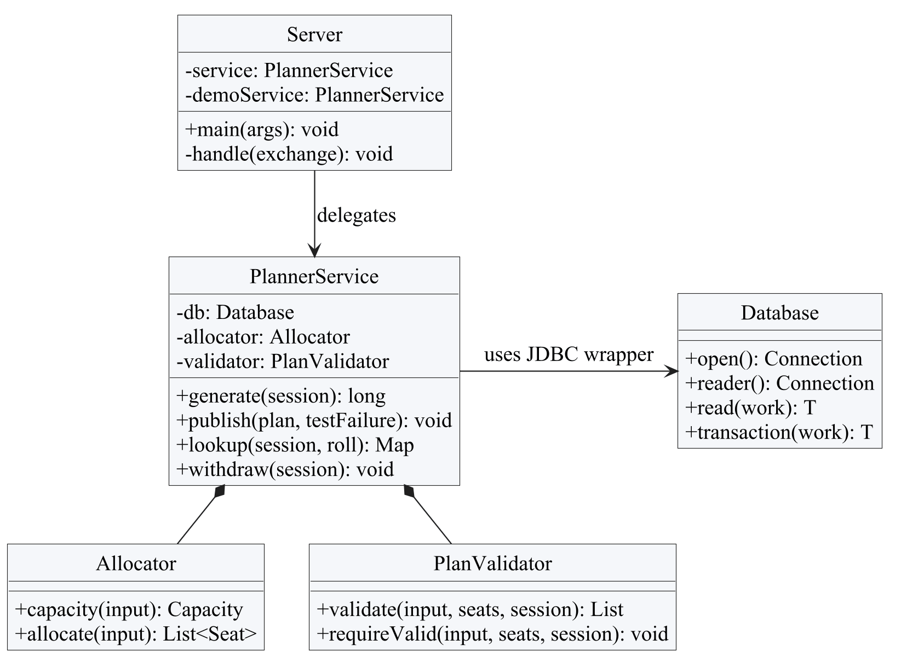
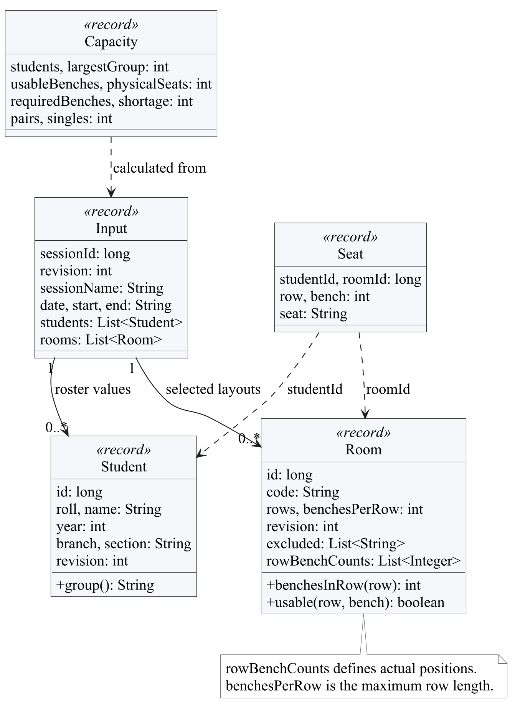
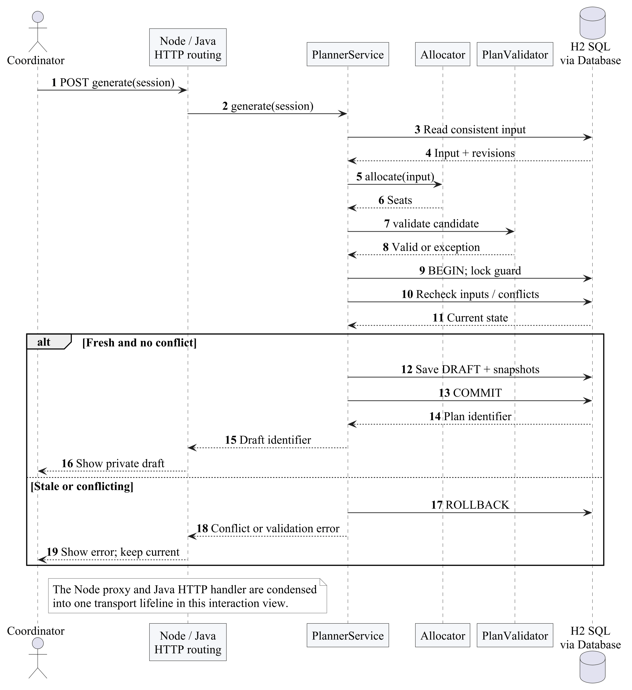
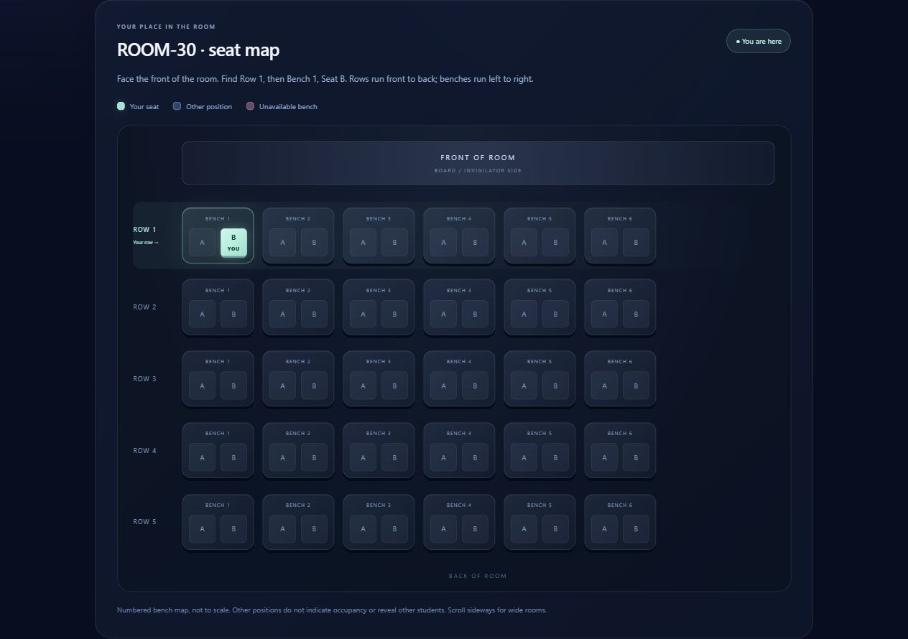
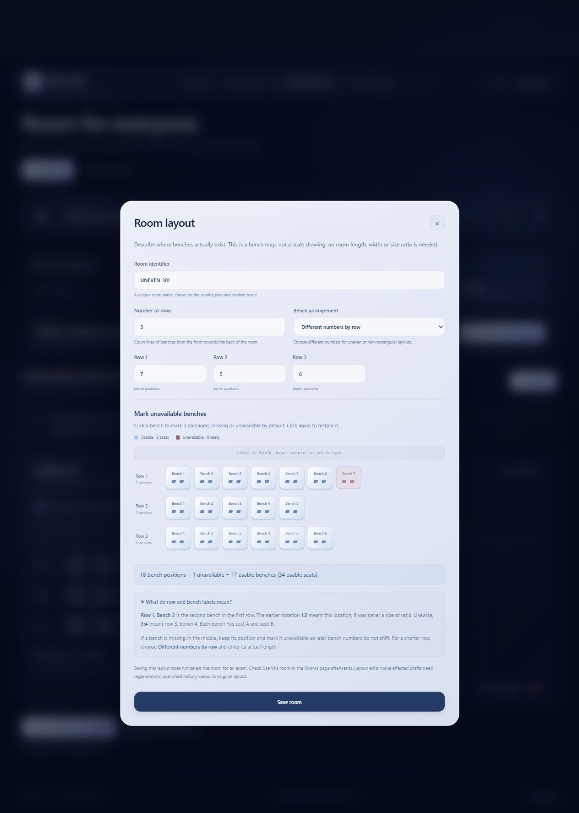

# Seyra Java Programming Report

Java objects, records, collections, exception handling, functional interfaces, HTTP concurrency and JDBC transactions implement the exam workflow. This report concentrates on those Java responsibilities and the independent verification of the allocator.

## 1 INTRODUCTION

Seyra is a working exam hall seating planner. A coordinator saves an exam session, its student roster and the rooms available for that sitting. Java generates a private draft, checks every placement and publishes a reviewed version. Students look up their roll number and see the exact A or B seat highlighted in the published room layout.

The problem is more specific than placing names in a rectangular grid. Two students may share a bench only when their years differ or their branches differ. Different sections alone do not make a pair eligible. A room may have seven benches in one row and five in another. Missing or damaged positions must not silently reappear, and an edited roster must not change an already published historical plan.

The completed system uses Java 21 for business rules and JDBC, H2 for the tested SQL database, a Node.js HTTP server for pages and API forwarding, and plain HTML, CSS and JavaScript for the browser interface. The hosted Render service exposes a shared fictional demonstration. Its temporary database resets on restart; the local workspace stores its own records separately.

## 2 EXISTING SYSTEM

A manual spreadsheet approach asks the coordinator to compare student groups, calculate capacity, place names, check duplicates and distribute a final list. This is the reference workflow being improved, not a measured study of a particular college's existing software.

Counting empty seats alone is insufficient. Consider 30 second-year AI_ML students and 10 second-year CSE students. There are 40 students, but the first group needs 30 separate benches. Twenty-four benches provide 48 physical seats and still fall six benches short under the sharing rule. A spreadsheet that divides the roster by two can therefore approve an impossible arrangement.

Copying a spreadsheet after each edit also makes the current publication unclear. A student may receive an older copy while the coordinator has a newer draft. Room changes can erase the layout associated with a previous sitting. Seyra addresses these problems through explicit publication, immutable plan snapshots and a student view tied to one current version.

## 3 PROPOSED SYSTEM

The coordinator follows five visible stages: save the session time, choose the student roster, select and configure rooms, generate and review a draft, then publish it. The interface explains what is missing before the next action. Unsaved form changes must be saved before generation so that the draft corresponds to stored inputs.

Each usable bench has positions A and B. The room editor accepts the actual bench count for every row; for example, 7, 5, 6 means three rows with those respective counts. It is not a 7:5:6 scale or screen aspect ratio. Whole benches can be excluded by room default or for a particular session. The map preserves their coordinates so a later bench is not renumbered into a damaged position.

The allocator groups students by year and branch, pairs eligible groups and allows single occupancy. A separate validator checks the resulting placements. Generated plans remain DRAFT until the coordinator explicitly publishes them. Publication checks current inputs and room conflicts again, then replaces the previous publication atomically. Students receive only the current published assignment and their assigned room geometry.

The scope is a small coordinator-managed examination workflow. The current rule concerns bench sharing; it does not promise separation between adjacent benches, optimal walking distance, accessible-seat placement or invigilation staffing. Those would require additional requirements and a different feasibility model.

## 4 HARDWARE AND SOFTWARE REQUIREMENTS

### Software used

| Component | Tested configuration | Purpose |
| --- | --- | --- |
| Java | Temurin JDK 21.0.13+9 | HTTP API, allocation, validation, JDBC and optional Swing client |
| Node.js | 24.20.0; project engine accepts 20 or later | Static pages, API proxy and development scripts |
| Database | H2 2.4.240 | File persistence, SQL constraints, views and transactions |
| JSON | Jackson 2.18.3 | Java request and snapshot serialization |
| Browser | Chrome on Windows | Coordinator, student and print-preview checks |
| Hosting | Render free Docker web service | Fictional shared HTTPS demonstration |

### Hardware and installation

Development and testing used a Windows laptop. No measured minimum CPU, memory requirement or maximum supported workload is claimed. A laptop able to run Java 21, Node.js and a modern browser is sufficient to reproduce the recorded small synthetic examples. A network connection is needed to download libraries and use the hosted demonstration; the local application uses loopback HTTP.

Install Java 21 and Node.js, run `node scripts/download-libraries.mjs`, then `npm test` and `npm start` from the project directory. Open `http://127.0.0.1:3000`. The practice workspace is `/demo`. The Dockerfile builds the same application for Render. Local database files, credentials and generated submission reports are excluded from Git.

The repository also contains an optional MySQL schema and environment configuration path. A MySQL server was not exercised in the recorded tests. H2 is the verified database described in this report; SQL syntax and stored routines must not be presented as verified MySQL or Oracle PL/SQL implementations.

## 5 IMPLEMENTATION

### Java module structure

The Java backend is deliberately small enough to trace during a lab demonstration. `Server` maps HTTP requests to service methods. `PlannerService` applies workflow rules and coordinates SQL operations. `Allocator` produces candidate seats, while `PlanValidator` checks those seats independently. `Database` owns JDBC connections, prepared statements and transaction boundaries. `Domain` defines records and the application exception. `Csv` handles quoted CSV import, and `Json` centralizes Jackson serialization. `SwingCoordinator` is an optional Java desktop client; `DbLab` demonstrates H2 routines and triggers in an isolated database.

This separation gives each class a concrete responsibility. A servlet container, Spring Boot and an ORM are not used. Java's built-in HTTP server accepts requests from the Node proxy; the business rules remain in Java rather than being duplicated as browser authority.



### Records and domain modeling

`Domain.Student` stores identity, roll, name, year, branch, section and revision. `Room` stores its identity and code, actual row counts, exclusions and revision. `Input` is a session snapshot containing time, roster and selected rooms. `Seat` identifies a student and one room, row, bench and A/B position. `Capacity` names the values displayed by the feasibility check instead of returning an unexplained array of numbers.

Records provide concise typed values and generated accessors. A record reference being final does not make a mutable collection deeply immutable. The implementation uses copied lists where appropriate, including `List.copyOf(seats)` for the allocation result. The room model preserves older snapshots that stored only a repeated rectangular count, while newer snapshots retain actual counts for every row.

An internal allocator `Group` contains a year, branch and `ArrayDeque<Student>`. It encapsulates the queue used while pairing. Meaningful inheritance appears in `Domain.Problem extends RuntimeException` and the optional Swing window extending `JFrame`. There is no artificial student-to-branch inheritance: a student's branch is data, not a subclass relationship.



### Collections and capacity calculation

A `HashMap` counts students by the key formed from year and branch. Let N be the roster size and M the size of its largest such group. The minimum required number of benches is `max(ceil(N / 2), M)`. At least half as many benches as students are necessary because a bench holds at most two people. At least M benches are necessary because members of the largest group cannot share with one another.

The bound is sufficient for this model because students may use any selected usable bench, and any two different year/branch groups are compatible. There are no fixed seats, per-student room restrictions or half-bench exclusions. With a dominant group, pair its members with other groups and seat the remainder singly. With no dominant group, repeated pairing across groups reaches the half-roster bound. The implementation also tests the formula against an independent exhaustive search for small group counts.

The Java capacity code uses integer arithmetic `(n + 1) / 2` for the ceiling and `Math.max` for the two lower bounds. It counts actual usable benches by nested row/bench loops rather than multiplying the largest row length by the number of rows. Physical seats, required benches and shortage are distinct displayed values.

### Priority queue allocation

The allocator sorts students within a group by roll, then places groups in a `PriorityQueue`. Its comparator orders groups by decreasing remaining size, followed by year and branch. Each iteration removes the two largest groups, takes one student from each, and reinserts nonempty groups. Remaining students from a single group occupy separate benches. Groups are removed before their queue sizes change, so changing priorities does not invalidate the heap's ordering.

```java
Group a = heap.remove(), b = heap.remove();
units.add(List.of(a.students.removeFirst(),
                  b.students.removeFirst()));
if (!a.students.isEmpty()) heap.add(a);
if (!b.students.isEmpty()) heap.add(b);
```

This is the actual pairing step from `Allocator.allocate`, formatted across lines for the report. The result is a list of one- or two-student units. A second traversal visits rooms sorted by code, actual rows and usable bench positions; it assigns the first occupant A and the second B. Deterministic tie breaking and ordering make the same stored input reproducible.

For N students, G groups and P enumerated room positions, the main costs are sorting students and rooms, queue pairing and traversing positions. A useful bound is O(N log N + N log G + R log R + P), where R is the number of selected rooms. This is an analysis of the code, not a measured latency guarantee. Memory includes the students, groups, units, seats and the input layout.

### Independent validation and exceptions

`PlanValidator` does not call the allocator. It builds maps of allowed students and rooms, sets of seen students and seat coordinates, and a map from each bench to its occupants. It checks exact roster coverage, duplicate students, unknown students, selected usable geometry, seat labels, duplicate positions, no more than two occupants and the year/branch rule. It also verifies that the snapshot belongs to the requested session.

Returning a list of errors permits a useful combined explanation. `requireValid` converts a failing result into `Domain.Problem` with HTTP conflict status. Expected domain errors retain their status through the database layer. SQL integrity errors are translated to a readable conflict; unexpected database failures return an unavailable response after rollback. Server logs retain the technical exception without presenting raw SQL details as normal user guidance.



### Functional interfaces and JDBC resource management

`Database.Work<T>` is a functional interface whose `run(Connection)` method returns a typed result and can throw an exception. Service methods pass lambdas to `read` or `transaction`. This keeps connection handling in one place while the lambda expresses the particular SQL task. It is a practical use of generics, interfaces and lambda expressions in the project.

```java
@FunctionalInterface public interface Work<T> {
    T run(Connection c) throws Exception;
}
```

JDBC operations use `PreparedStatement` placeholders and bind values through `setObject`. Connections, statements and result sets are enclosed in try-with-resources blocks. This closes them on success and failure. An input roll is a bound value, not SQL text concatenated into a query. Result-set metadata is used to construct named row maps; SQL dates, times and CLOB values are converted for JSON responses.

Transactions disable auto-commit, set READ_COMMITTED and lock the coordinator guard row before decision reads. Successful work commits; exceptions roll back before the connection closes. Generation performs allocation outside the write lock, then reacquires the lock and checks that the saved input fingerprint still matches before storing the draft. This avoids holding a write lock during the whole algorithm without saving a result based on silently changed inputs.

### Concurrency and HTTP handling

The Java HTTP server uses a bounded thread-pool executor with four core threads, at most eight threads and a queue of 64 tasks. These are configuration choices, not a proven maximum concurrent-user capacity. Database serialization protects the room-selection and publication decisions that can conflict even when requests arrive on different HTTP threads.

Publication validates status, session ownership, freshness, reservations and placements within the protected workflow. The old version becomes SUPERSEDED, the replacement becomes PUBLISHED and the session's current pointer changes in one transaction. A repeated request for an already current publication is idempotent. A deliberately injected pre-commit failure in the test suite confirms that a failed replacement cannot leave two half-published states.

### Input processing and optional desktop client

The CSV parser supports quoted fields rather than splitting every line at commas. The service normalizes and validates imported rows before committing the batch; an invalid row does not leave a partly imported roster. Jackson handles JSON records and serialized plan inputs. A canonical fingerprint detects meaningful input changes, including support for historical snapshot forms.

The Swing coordinator demonstrates a Java GUI client and background event work while reusing the service architecture. It is optional: the recorded user workflow and deployment use the browser. Compilation of Swing classes is verified; no claim is made that its native window interactions were tested. The principal Java learning outcomes are therefore supported by executed backend code as well as inspectable GUI source.

## 6 RESULTS

### Recorded verification

The final application test run on 2 November 2026 passed 3,068 Java assertions, including 1,000 exhaustive small group-count vectors, and seven Node tests. These are assertion and test counts, not a coverage percentage or 3,068 independent user scenarios. The exhaustive oracle recursively searches small partitions independently of the greedy allocator.

| Scenario | Observed result |
| --- | --- |
| 30 AI_ML plus 10 CSE students, same year | 30 benches needed; 10 pairs and 20 single occupants |
| The same roster with 24 usable benches | Generation refused with a six-bench shortage |
| Uneven rows and excluded positions | Only real usable coordinates receive assignments |
| Invalid or duplicate assignments | Independent validator rejects the candidate |
| Private draft and stale inputs | Draft remains private; stale publication is refused |
| Injected failure before publication commit | Old publication survives; replacement stays DRAFT |
| Two overlapping sessions selecting one room | Exactly one competing selection succeeds |
| Restricted SQL reader | Publication views readable; base-table access and writes denied |

Six focused local browser checks and seven live HTTPS browser checks passed for the student-portal repair and deployment. The live checks included sample lookup, exact A/B highlighting, generation, explicit publication, refresh to version 2 and print preview. These focused runs supplement earlier recorded interface checks; they are not a claim that every historical browser suite was rerun.

### Demonstration procedure

Open the hosted demo or local `/demo`. The initial example contains 40 fictional students and two rooms. In the student portal, enter `0001` to see seat A or `0031` to see seat B in ROOM-30 at row 1, bench 1. The map highlights one exact position and marks unavailable benches without exposing other students' identities. Shared-demo edits can change the current version, so use the reset practice action if the starter data has been changed.

To demonstrate publication, change fictional inputs, save them, generate a draft and review the coordinator output. Students continue to see the earlier publication until Publish succeeds. Return to the student portal and refresh to observe the new version. Withdraw the publication to show that an old assignment is cleared rather than left on screen.

### Boundaries of the evidence

The optional Swing sources compile, but native Swing interaction was not exercised. Physical printing, MySQL execution, large-scale load, a complete accessibility audit and durable production hosting were not verified. Browser print preview was checked. The public free Render service can sleep after inactivity and its fictional data resets on restart. These limits are separate from the passing local SQL and allocation checks.






## 7 CONCLUSION

Seyra implements the complete path from saved exam inputs to a validated draft, explicit publication and student seat lookup. Its capacity calculation reflects the sharing rule, its layouts support uneven rows, and its publication snapshots keep earlier facts separate from mutable master data. The recorded tests support these behaviors for the stated model and synthetic cases.

Future work should start with agreed requirements: authenticated coordinator accounts, durable hosted storage, backup and restore checks, accessible seating constraints and institution-specific policies. Each addition needs matching validation and migration tests. The current shared demo is appropriate for explaining and examining the project, rather than holding live examination records.

### References

1. [Java 21 API documentation](https://docs.oracle.com/en/java/javase/21/docs/api/)
2. [H2 documentation](https://h2database.com/html/main.html)
3. [Project source and tests](https://github.com/Koushik-026/seyra)
4. [Live fictional demonstration](https://seyra-exam-planner.onrender.com)

### Source and evidence locations

Application source is under `backend/` and `web/`; SQL is under `database/`; automated tests are under `backend/src/test/` and `tests/`. The current verification record is [verification-results.md](../verification-results.md). Editable diagram sources and rendered figures are in [diagrams](../diagrams/README.md). Local execution logs and personalized submission copies are excluded from the public repository.
