# Seyra Software Engineering Report

Requirements, design models and test evidence explain how the implemented workflow meets its stated scope. This report concentrates on useful UML views, data flow, traceability, failure cases and maintenance decisions.

## 1 INTRODUCTION

Seyra is a working exam hall seating planner. A coordinator saves an exam session, its student roster and the rooms available for that sitting. Java generates a private draft, checks every placement and publishes a reviewed version. Students look up their roll number and see the exact A or B seat highlighted in the published room layout.

The problem is more specific than placing names in a rectangular grid. Two students may share a bench only when their years differ or their branches differ. Different sections alone do not make a pair eligible. A room may have seven benches in one row and five in another. Missing or damaged positions must not silently reappear, and an edited roster must not change an already published historical plan.

The completed system uses Java 21 for business rules and JDBC, H2 for the tested SQL database, a Node.js HTTP server for pages and API forwarding, and plain HTML, CSS and JavaScript for the browser interface. The hosted Render service exposes a shared fictional demonstration. Its temporary database resets on restart; the local workspace stores its own records separately.

## 2 EXISTING SYSTEM

A manual spreadsheet approach asks the coordinator to compare student groups, calculate capacity, place names, check duplicates and distribute a final list. This is the reference workflow being improved, not a measured study of a particular college's existing software.

Counting empty seats alone is insufficient. Consider 30 second-year AI_ML students and 10 second-year CSE students. There are 40 students, but the first group needs 30 separate benches. Twenty-four benches provide 48 physical seats and still fall six benches short under the sharing rule. A spreadsheet that divides the roster by two can therefore approve an impossible arrangement.

Copying a spreadsheet after each edit also makes the current publication unclear. A student may receive an older copy while the coordinator has a newer draft. Room changes can erase the layout associated with a previous sitting. Seyra addresses these problems through explicit publication, immutable plan snapshots and a student view tied to one current version.

## 3 PROPOSED SYSTEM

The coordinator follows five visible stages: save the session time, choose the student roster, select and configure rooms, generate and review a draft, then publish it. The interface explains what is missing before the next action. Unsaved form changes must be saved before generation so that the draft corresponds to stored inputs.

Each usable bench has positions A and B. The room editor accepts the actual bench count for every row; for example, 7, 5, 6 means three rows with those respective counts. It is not a 7:5:6 scale or screen aspect ratio. Whole benches can be excluded by room default or for a particular session. The map preserves their coordinates so a later bench is not renumbered into a damaged position.

The allocator groups students by year and branch, pairs eligible groups and allows single occupancy. A separate validator checks the resulting placements. Generated plans remain DRAFT until the coordinator explicitly publishes them. Publication checks current inputs and room conflicts again, then replaces the previous publication atomically. Students receive only the current published assignment and their assigned room geometry.

The scope is a small coordinator-managed examination workflow. The current rule concerns bench sharing; it does not promise separation between adjacent benches, optimal walking distance, accessible-seat placement or invigilation staffing. Those would require additional requirements and a different feasibility model.

## 4 HARDWARE AND SOFTWARE REQUIREMENTS

### Software used

| Component | Tested configuration | Purpose |
| --- | --- | --- |
| Java | Temurin JDK 21.0.13+9 | HTTP API, allocation, validation, JDBC and optional Swing client |
| Node.js | 24.20.0; project engine accepts 20 or later | Static pages, API proxy and development scripts |
| Database | H2 2.4.240 | File persistence, SQL constraints, views and transactions |
| JSON | Jackson 2.18.3 | Java request and snapshot serialization |
| Browser | Chrome on Windows | Coordinator, student and print-preview checks |
| Hosting | Render free Docker web service | Fictional shared HTTPS demonstration |

### Hardware and installation

Development and testing used a Windows laptop. No measured minimum CPU, memory requirement or maximum supported workload is claimed. A laptop able to run Java 21, Node.js and a modern browser is sufficient to reproduce the recorded small synthetic examples. A network connection is needed to download libraries and use the hosted demonstration; the local application uses loopback HTTP.

Install Java 21 and Node.js, run `node scripts/download-libraries.mjs`, then `npm test` and `npm start` from the project directory. Open `http://127.0.0.1:3000`. The practice workspace is `/demo`. The Dockerfile builds the same application for Render. Local database files, credentials and generated submission reports are excluded from Git.

The repository also contains an optional MySQL schema and environment configuration path. A MySQL server was not exercised in the recorded tests. H2 is the verified database described in this report; SQL syntax and stored routines must not be presented as verified MySQL or Oracle PL/SQL implementations.

## 5 IMPLEMENTATION

### Scope, stakeholders and requirements

The coordinator maintains the sitting inputs, decides whether a draft is acceptable and publishes it. The student needs a current assignment and understandable directions within the room. Faculty reviewers need a design that can be traced to source and test evidence. Seyra supports these roles through one shared system, with separate subject reports describing the relevant implementation.

| ID | Functional requirement | Acceptance condition |
| --- | --- | --- |
| FR1 | Save an exam sitting | Valid date and start time earlier than end time |
| FR2 | Maintain its roster | Unique rolls; valid year and branch; no partial invalid import |
| FR3 | Configure actual rooms | Uneven row counts and unavailable benches preserved |
| FR4 | Generate a private draft | Sufficient usable benches and exact valid roster coverage |
| FR5 | Publish a reviewed version | Fresh inputs; no overlapping room conflict; atomic replacement |
| FR6 | Show student position | Current published assignment and exact A/B highlight |
| FR7 | Retain history and withdraw | Earlier facts stable; withdrawn lookup no longer shown |

Quality requirements are stated without invented numerical targets. Determinism means identical saved input produces the same placement order. Integrity means invalid assignments and inconsistent SQL references are rejected. Usability means the next required action and input meaning are visible. Privacy means the student endpoint exposes the matched assignment rather than the full roster. Performance and accessibility have no claimed production certification.

### Process and design decisions

Development proceeded through a working allocation and SQL baseline, interface revisions, clearer workflow and uneven-room support, branding and student-map work, then student-portal repair and deployment. Each revision used focused regression checks. This is an account of the recorded incremental work, not a claim that a formal Scrum team, planned sprint schedule or fabricated effort estimate was followed.

The backend/frontend split was chosen to meet the four-lab project scope: Java owns rules and JDBC, Node serves the web application, SQL enforces relationships, and the SE view explains requirements, models and verification. The current code uses Java HttpServer, built-in Node HTTP and H2. React, Spring Boot, Django and JWT authentication are not implemented requirements of this completed version.

### Use case model

The use-case diagram separates coordinator operations from the student's published lookup. Generation includes feasibility and assignment validation. Publication includes freshness and reservation checks. The actor is the role performing an operation; a database is not an external human actor. The diagram states supported goals, not a navigation map for every browser button.

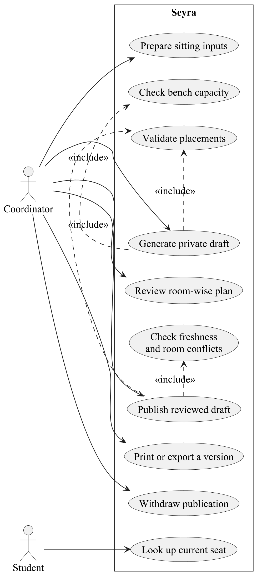

### Structural and domain models

The class model shows implementation responsibilities and dependencies: HTTP Server to PlannerService, service to Database, Allocator and PlanValidator, and shared typed Domain records. The separate domain-record view expands Input, Student, Room, Seat and Capacity without hiding their data under an oversized single class box. These are views of the Java implementation rather than a proposed unrelated framework design.

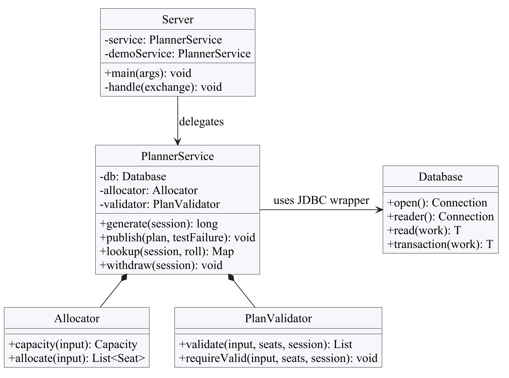

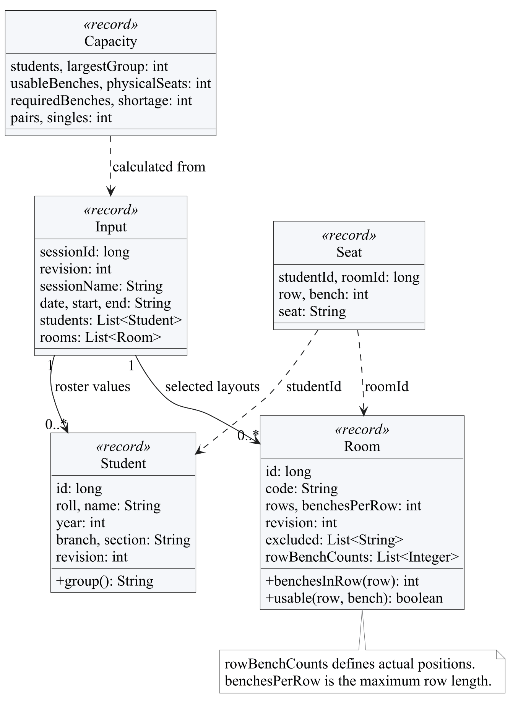

The object diagram is an illustrative instance at one moment: fictional rolls 0001 and 0031 share ROOM-30 row 1 bench 1, at A and B respectively. Object values make the static types concrete. They are synthetic demonstration records, not personal student data.

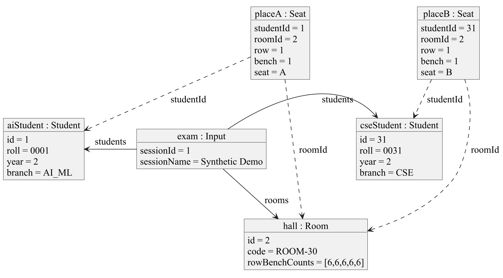

### Activity and state models

The activity model makes the user procedure predictable. Saved session, roster and room inputs precede generation. A failed feasibility check returns to input correction; a valid draft proceeds to review and an explicit publish action. The separate publication activity expands the checks, commit and failure paths that would clutter the main coordinator workflow.

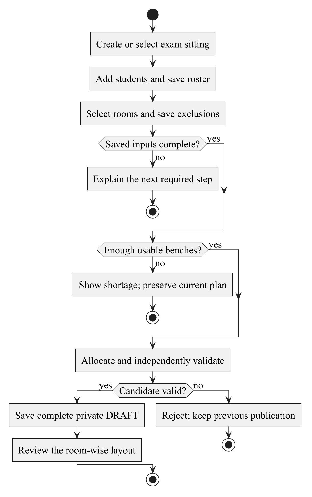

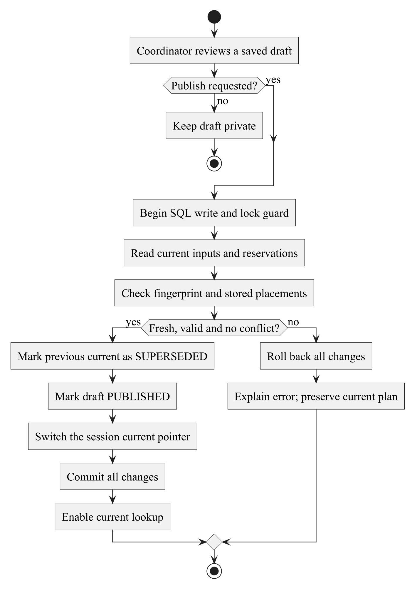

The state model distinguishes a generated DRAFT from a current PUBLISHED plan. A replaced publication becomes SUPERSEDED, a removed publication WITHDRAWN, and an abandoned draft DISCARDED. This lifecycle explains why a saved candidate is not visible in the student portal and why an older result must not be silently edited into a new one.

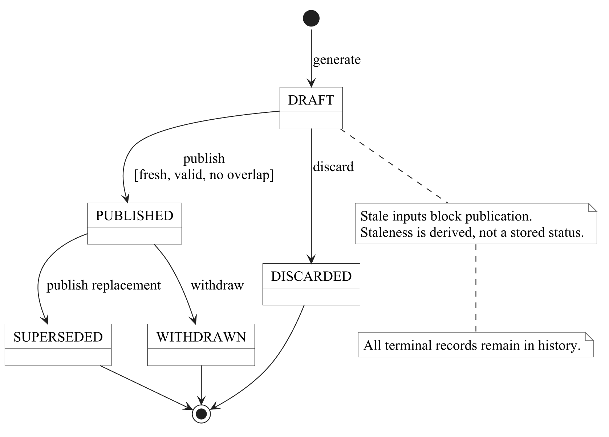

### Interaction models

The generation sequence shows reading saved inputs, computing capacity and placement, independently validating and saving a complete candidate after a freshness check. The publication sequence shows the guarded transaction, status checks, rollback and idempotent retry. The student sequence follows a restricted read of the current assignment and matching room geometry.

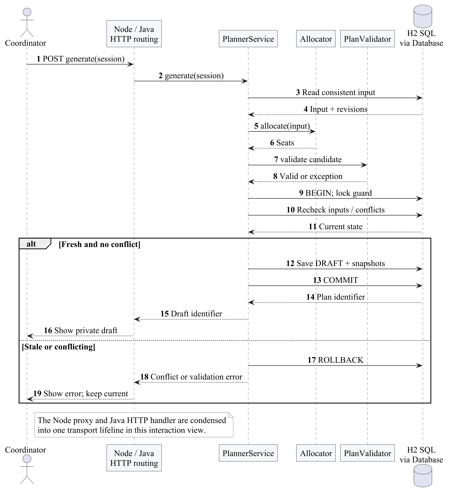

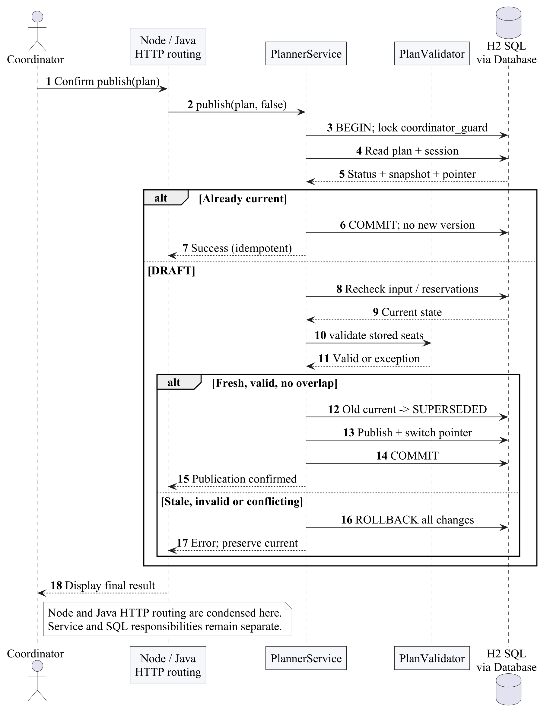

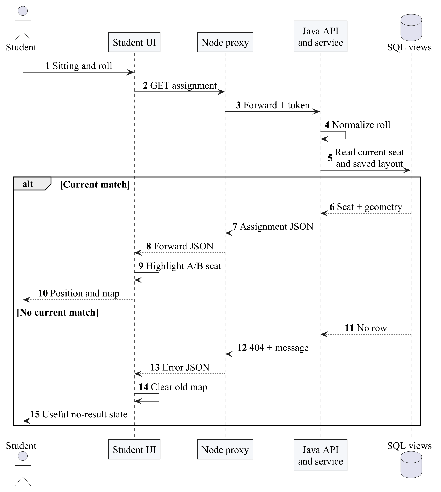

The communication diagram provides the publication interaction as numbered messages between collaborating objects. It answers which objects exchange requests, while the sequence view makes ordering and alternative outcomes easier to inspect. The HTTP transport is condensed in these interaction views so that the service decisions remain readable; the component and deployment models show the actual Node-to-Java boundary.

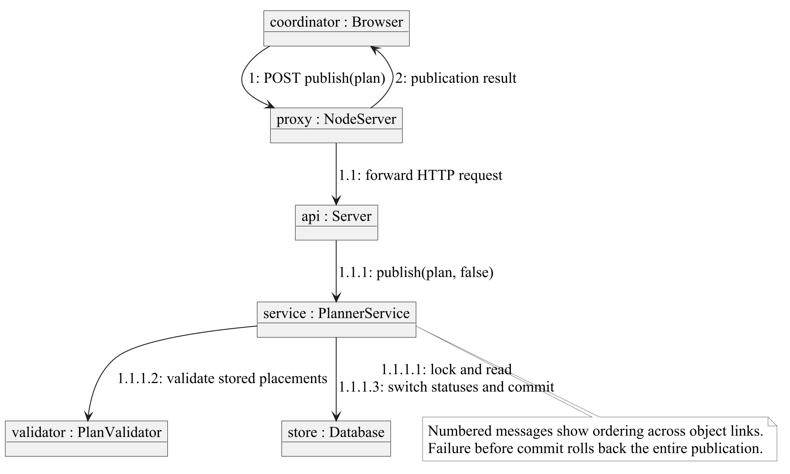

### Components and deployment

The component view separates browser pages and shared rendering, the Node HTTP/proxy boundary, Java service modules and SQL persistence. The deployment view places browser clients outside a Render Docker service, with one public Node listener, a loopback Java backend and H2 files inside the service container. It records the deployed free-demo configuration, including ephemeral storage, rather than claiming a managed persistent database.

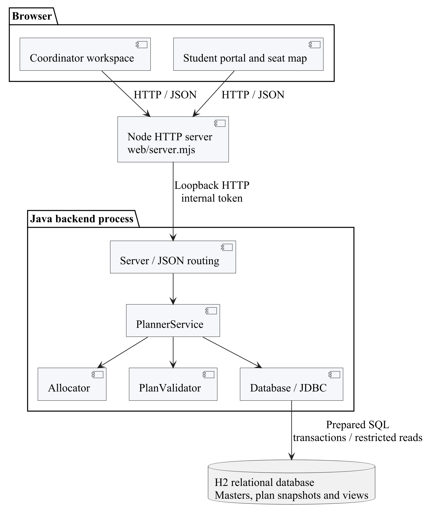

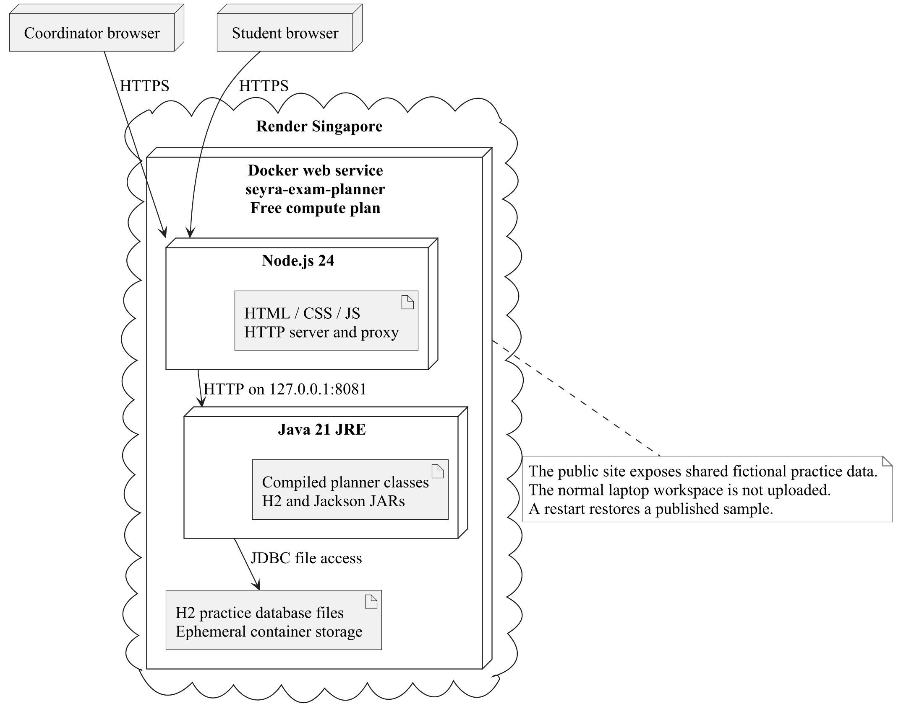

### Data design and data flow

ER diagrams supplement UML by specifying the actual master, session and snapshot relations. They are provided in the DBMS report and the shared diagram directory. The context DFD shows information crossing the system boundary. Its level-one refinement separates input maintenance, generation, publication and lookup and identifies logical stores backed by the implemented SQL tables. DFDs and ER models are not mislabeled as UML diagrams.

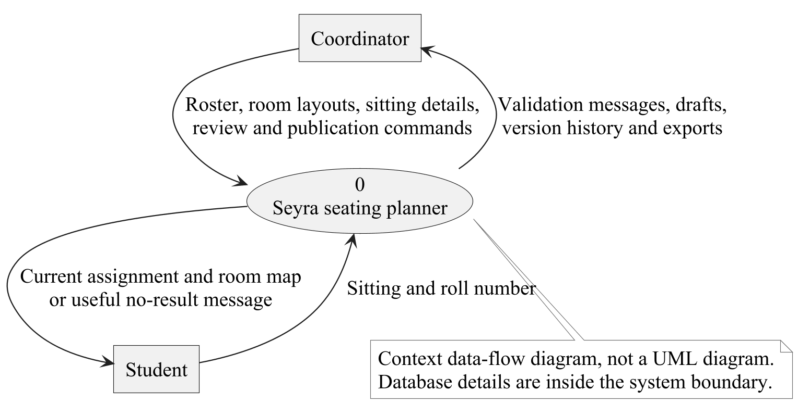

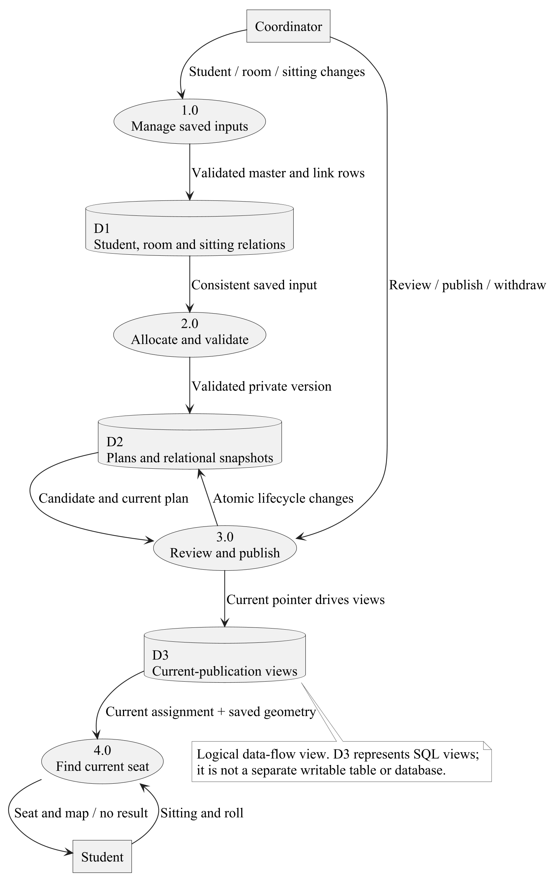

These selected diagrams cover nine useful UML types: use case, class, object, activity, state machine, sequence, communication, component and deployment. Timing and profile diagrams are not added merely to increase the count: the current application has no specified real-time protocol or custom UML metamodel requiring them. The editable PlantUML sources are included so reviewers can inspect and revise the models.

### Traceability and test design

| Requirement | Main implementation | Verification evidence |
| --- | --- | --- |
| FR1 and FR2 | PlannerService, Csv, schema constraints | Input validation and all-or-nothing import assertions |
| FR3 | Domain.Room, room_benches, seating.js | Uneven-row, exclusion and historical geometry checks |
| FR4 | Allocator and PlanValidator | Exhaustive oracle and malformed-candidate rejection |
| FR5 | Database.transaction and publish | Conflict race, stale draft, rollback and retry checks |
| FR6 | Published views and student modules | Restricted reader plus local/live A/B browser checks |
| FR7 | Plan snapshots and status transitions | Historical stability and withdrawal checks |

Equivalence classes include compatible and incompatible group pairs, empty and nonempty rosters, selected and unselected rooms, and valid and malformed CSV. Boundary cases include odd student counts, exactly enough benches, one-group dominance and back-to-back exam intervals. Negative tests submit duplicate seats and unknown students directly to the validator. The oracle compares independent exhaustive results rather than merely restating the implementation.

System tests follow the whole browser-to-Node-to-Java-to-SQL path. An API success is checked against the visible student result and version. Failure injection before commit tests atomicity, and concurrent selection tests a race that a single-user walkthrough would not expose. Browser screenshots support visual review but are not treated as evidence that unseen server rules passed.

### Risks, change control and maintenance

The principal remaining deployment risk is temporary hosted storage. The public service therefore contains fictional data and states that restart resets it. Authentication, durable hosting and backup/restore must be designed before live exam use. Room geometry currently models discrete bench positions, not measured floor plans; accommodating accessible places or fixed seats requires changes to both the algorithm and its feasibility proof.

Configuration and checksum-pinned dependencies are versioned, while passwords, local databases and generated personalized reports are ignored. Changes should update code, tests and affected diagrams together. A runtime release should pass allocation, SQL and browser checks appropriate to its change. Documentation-only synchronization can avoid restarting the shared demo.

## 6 RESULTS

### Recorded verification

The final application test run on 2 November 2026 passed 3,068 Java assertions, including 1,000 exhaustive small group-count vectors, and seven Node tests. These are assertion and test counts, not a coverage percentage or 3,068 independent user scenarios. The exhaustive oracle recursively searches small partitions independently of the greedy allocator.

| Scenario | Observed result |
| --- | --- |
| 30 AI_ML plus 10 CSE students, same year | 30 benches needed; 10 pairs and 20 single occupants |
| The same roster with 24 usable benches | Generation refused with a six-bench shortage |
| Uneven rows and excluded positions | Only real usable coordinates receive assignments |
| Invalid or duplicate assignments | Independent validator rejects the candidate |
| Private draft and stale inputs | Draft remains private; stale publication is refused |
| Injected failure before publication commit | Old publication survives; replacement stays DRAFT |
| Two overlapping sessions selecting one room | Exactly one competing selection succeeds |
| Restricted SQL reader | Publication views readable; base-table access and writes denied |

Six focused local browser checks and seven live HTTPS browser checks passed for the student-portal repair and deployment. The live checks included sample lookup, exact A/B highlighting, generation, explicit publication, refresh to version 2 and print preview. These focused runs supplement earlier recorded interface checks; they are not a claim that every historical browser suite was rerun.

### Demonstration procedure

Open the hosted demo or local `/demo`. The initial example contains 40 fictional students and two rooms. In the student portal, enter `0001` to see seat A or `0031` to see seat B in ROOM-30 at row 1, bench 1. The map highlights one exact position and marks unavailable benches without exposing other students' identities. Shared-demo edits can change the current version, so use the reset practice action if the starter data has been changed.

To demonstrate publication, change fictional inputs, save them, generate a draft and review the coordinator output. Students continue to see the earlier publication until Publish succeeds. Return to the student portal and refresh to observe the new version. Withdraw the publication to show that an old assignment is cleared rather than left on screen.

### Boundaries of the evidence

The optional Swing sources compile, but native Swing interaction was not exercised. Physical printing, MySQL execution, large-scale load, a complete accessibility audit and durable production hosting were not verified. Browser print preview was checked. The public free Render service can sleep after inactivity and its fictional data resets on restart. These limits are separate from the passing local SQL and allocation checks.

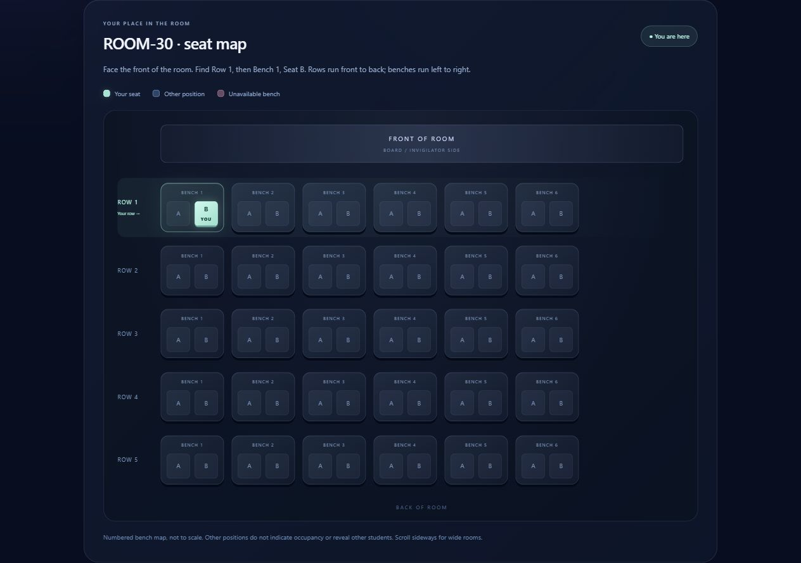

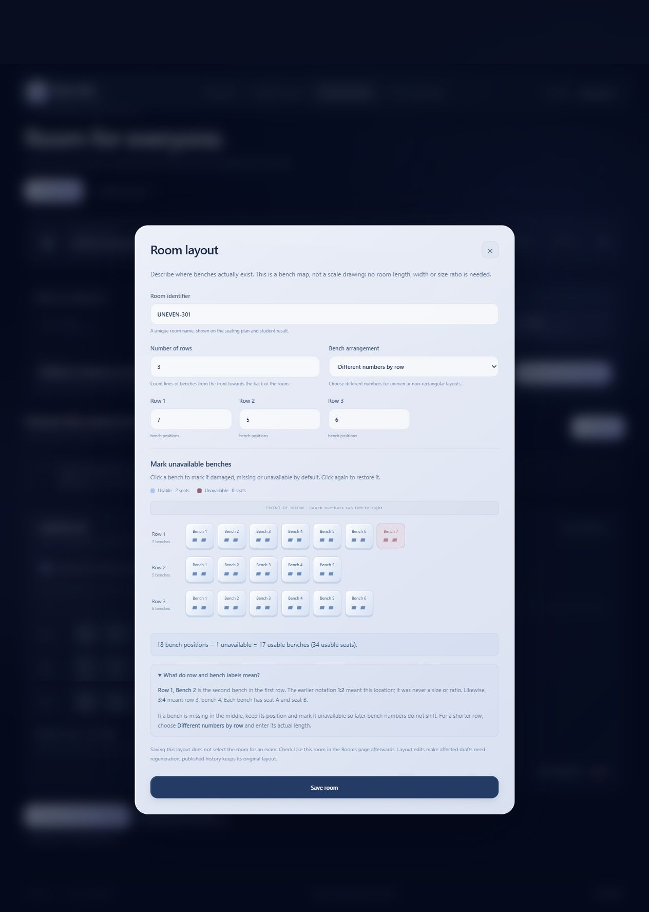

## 7 CONCLUSION

Seyra implements the complete path from saved exam inputs to a validated draft, explicit publication and student seat lookup. Its capacity calculation reflects the sharing rule, its layouts support uneven rows, and its publication snapshots keep earlier facts separate from mutable master data. The recorded tests support these behaviors for the stated model and synthetic cases.

Future work should start with agreed requirements: authenticated coordinator accounts, durable hosted storage, backup and restore checks, accessible seating constraints and institution-specific policies. Each addition needs matching validation and migration tests. The current shared demo is appropriate for explaining and examining the project, rather than holding live examination records.

### References

1. [OMG UML 2.5.1 specification](https://www.omg.org/spec/UML/2.5.1/About-UML)
2. [PlantUML diagram documentation](https://plantuml.com/)
3. [Project source and tests](https://github.com/Koushik-026/seyra)
4. [Live fictional demonstration](https://seyra-exam-planner.onrender.com)

### Source and evidence locations

Application source is under `backend/` and `web/`; SQL is under `database/`; automated tests are under `backend/src/test/` and `tests/`. The current verification record is [verification-results.md](../verification-results.md). Editable diagram sources and rendered figures are in [diagrams](../diagrams/README.md). Local execution logs and personalized submission copies are excluded from the public repository.
