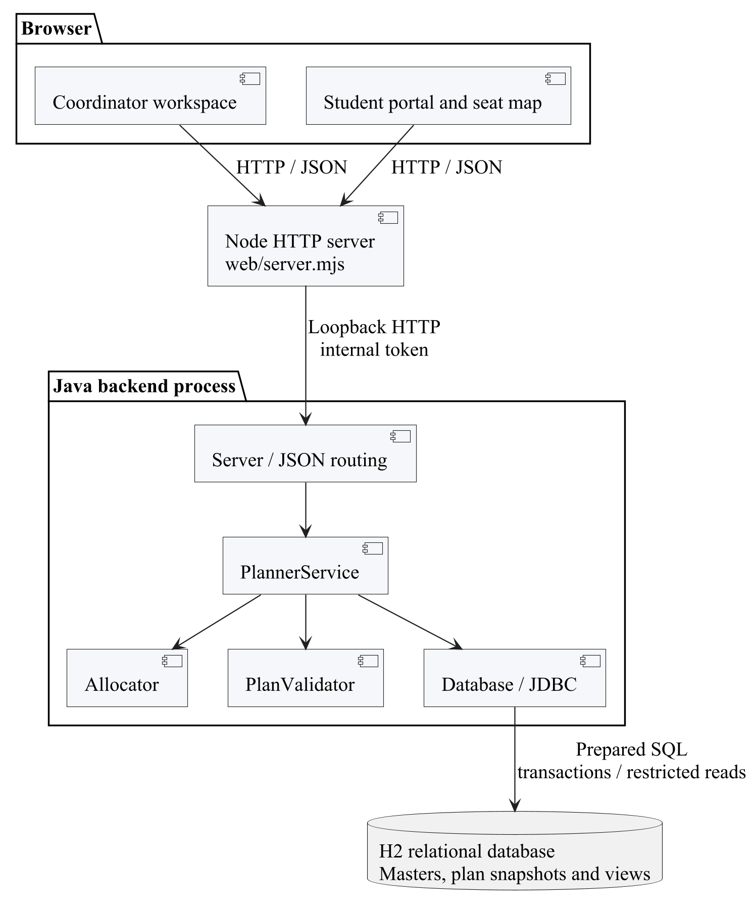
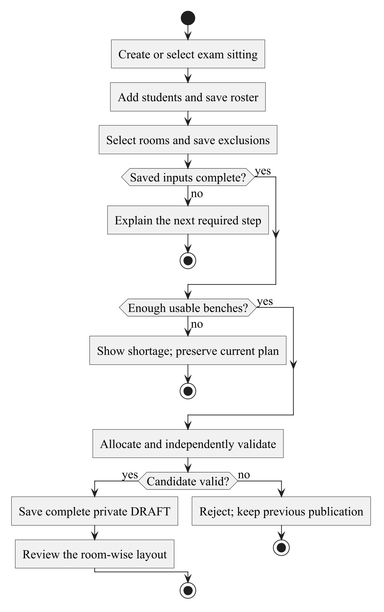
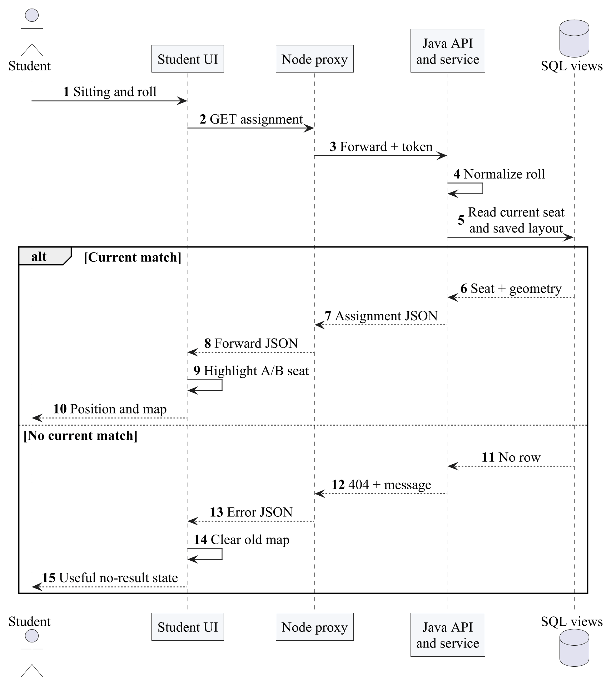
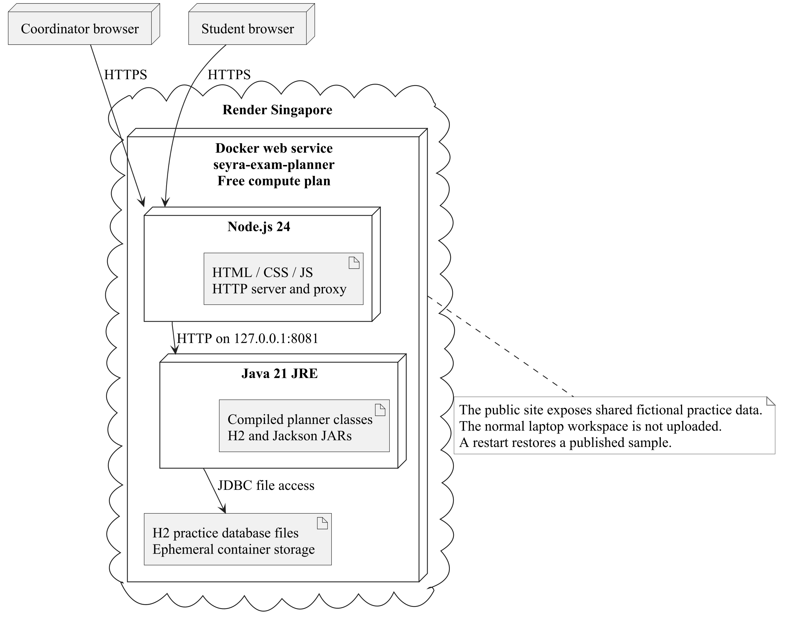
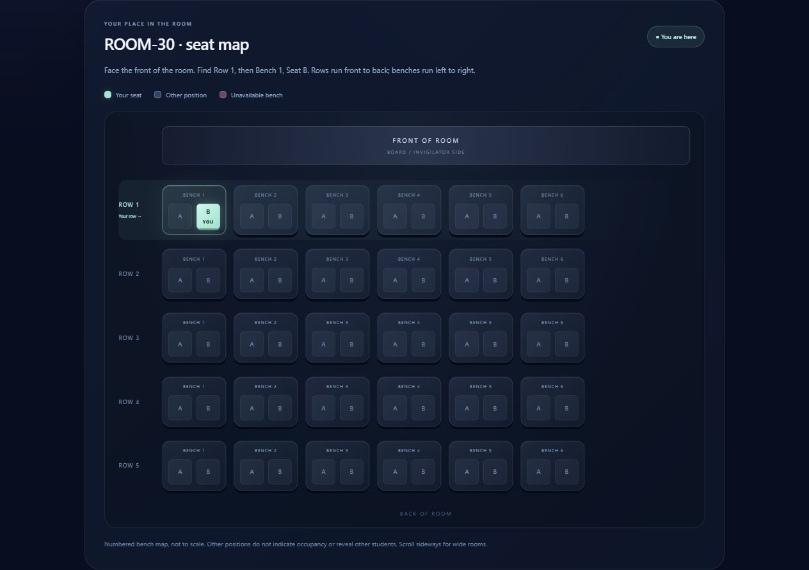
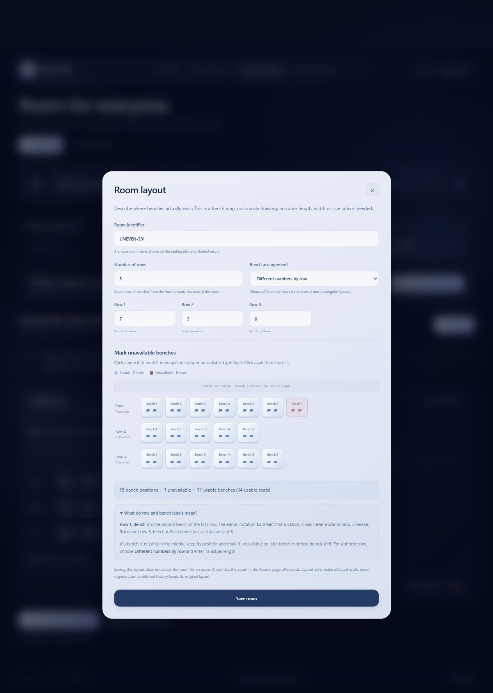

# Seyra Web Technologies Report

HTML, CSS, browser JavaScript and a Node.js server provide a guided coordinator workspace and a student portal. This report concentrates on forms, state handling, API requests, responsive layouts, safe room rendering and the deployed web path.

## 1 INTRODUCTION

Seyra is a working exam hall seating planner. A coordinator saves an exam session, its student roster and the rooms available for that sitting. Java generates a private draft, checks every placement and publishes a reviewed version. Students look up their roll number and see the exact A or B seat highlighted in the published room layout.

The problem is more specific than placing names in a rectangular grid. Two students may share a bench only when their years differ or their branches differ. Different sections alone do not make a pair eligible. A room may have seven benches in one row and five in another. Missing or damaged positions must not silently reappear, and an edited roster must not change an already published historical plan.

The completed system uses Java 21 for business rules and JDBC, H2 for the tested SQL database, a Node.js HTTP server for pages and API forwarding, and plain HTML, CSS and JavaScript for the browser interface. The hosted Render service exposes a shared fictional demonstration. Its temporary database resets on restart; the local workspace stores its own records separately.

## 2 EXISTING SYSTEM

A manual spreadsheet approach asks the coordinator to compare student groups, calculate capacity, place names, check duplicates and distribute a final list. This is the reference workflow being improved, not a measured study of a particular college's existing software.

Counting empty seats alone is insufficient. Consider 30 second-year AI_ML students and 10 second-year CSE students. There are 40 students, but the first group needs 30 separate benches. Twenty-four benches provide 48 physical seats and still fall six benches short under the sharing rule. A spreadsheet that divides the roster by two can therefore approve an impossible arrangement.

Copying a spreadsheet after each edit also makes the current publication unclear. A student may receive an older copy while the coordinator has a newer draft. Room changes can erase the layout associated with a previous sitting. Seyra addresses these problems through explicit publication, immutable plan snapshots and a student view tied to one current version.

## 3 PROPOSED SYSTEM

The coordinator follows five visible stages: save the session time, choose the student roster, select and configure rooms, generate and review a draft, then publish it. The interface explains what is missing before the next action. Unsaved form changes must be saved before generation so that the draft corresponds to stored inputs.

Each usable bench has positions A and B. The room editor accepts the actual bench count for every row; for example, 7, 5, 6 means three rows with those respective counts. It is not a 7:5:6 scale or screen aspect ratio. Whole benches can be excluded by room default or for a particular session. The map preserves their coordinates so a later bench is not renumbered into a damaged position.

The allocator groups students by year and branch, pairs eligible groups and allows single occupancy. A separate validator checks the resulting placements. Generated plans remain DRAFT until the coordinator explicitly publishes them. Publication checks current inputs and room conflicts again, then replaces the previous publication atomically. Students receive only the current published assignment and their assigned room geometry.

The scope is a small coordinator-managed examination workflow. The current rule concerns bench sharing; it does not promise separation between adjacent benches, optimal walking distance, accessible-seat placement or invigilation staffing. Those would require additional requirements and a different feasibility model.

## 4 HARDWARE AND SOFTWARE REQUIREMENTS

### Software used

| Component | Tested configuration | Purpose |
| --- | --- | --- |
| Java | Temurin JDK 21.0.13+9 | HTTP API, allocation, validation, JDBC and optional Swing client |
| Node.js | 24.20.0; project engine accepts 20 or later | Static pages, API proxy and development scripts |
| Database | H2 2.4.240 | File persistence, SQL constraints, views and transactions |
| JSON | Jackson 2.18.3 | Java request and snapshot serialization |
| Browser | Chrome on Windows | Coordinator, student and print-preview checks |
| Hosting | Render free Docker web service | Fictional shared HTTPS demonstration |

### Hardware and installation

Development and testing used a Windows laptop. No measured minimum CPU, memory requirement or maximum supported workload is claimed. A laptop able to run Java 21, Node.js and a modern browser is sufficient to reproduce the recorded small synthetic examples. A network connection is needed to download libraries and use the hosted demonstration; the local application uses loopback HTTP.

Install Java 21 and Node.js, run `node scripts/download-libraries.mjs`, then `npm test` and `npm start` from the project directory. Open `http://127.0.0.1:3000`. The practice workspace is `/demo`. The Dockerfile builds the same application for Render. Local database files, credentials and generated submission reports are excluded from Git.

The repository also contains an optional MySQL schema and environment configuration path. A MySQL server was not exercised in the recorded tests. H2 is the verified database described in this report; SQL syntax and stored routines must not be presented as verified MySQL or Oracle PL/SQL implementations.

## 5 IMPLEMENTATION

### Browser and server responsibilities

The web laboratory part uses semantic HTML, responsive CSS, browser JavaScript and a Node.js server. The Java backend owns allocation and publication decisions. Node receives browser requests, serves the static interface and forwards API calls to Java. This is a useful demonstration of a web application that combines a Java business backend with Node.js infrastructure.

Node uses its built-in `http` module; Express and a front-end framework are not runtime dependencies. The implementation can therefore be followed from request routing to response without a framework-generated project structure. JavaScript is split into coordinator, student, print and shared seating-rendering modules so a print page does not run coordinator-only DOM code.

### HTML forms and the visible workflow

The coordinator begins with an exam name, date, start time and end time. The student area needs roll, name, year, branch and optional section, or a valid CSV import. The room area needs a unique code, the actual number of benches per row and any unavailable positions. The review area reports both physical seat count and the rule-based bench requirement. Finally the coordinator generates a draft, inspects it and publishes it explicitly.

Labels, help text and status messages explain these inputs where they are used. A notation such as rows 7, 5, 6 describes counts, not room dimensions or a ratio. Missing benches remain excluded coordinates, which is important for giving students recognizable directions. The workflow does not ask users to infer the meaning of a decorative number such as 3:4 before they can proceed.

The interface tracks unsaved changes. Actions that depend on the stored roster or room selection guide the user to save first. Shared create/edit form state clears the hidden record identifier when entering a new record, preventing the earlier edit-to-create bug. Server-side validation still applies even if browser constraints are bypassed.

### Fetch requests and response handling

Browser modules make same-origin requests through Node using the Fetch API. They serialize form data as JSON where appropriate, check response success and show the returned domain message when an operation fails. A network failure and an HTTP error both need handling: obtaining a Response object alone does not mean the operation succeeded.

The UI updates from the successful server response and reloads stored state when required. For example, generation produces a plan identifier and a private review result; it does not automatically announce that students can see the plan. Only a successful publication changes the published status. A shortage response preserves the earlier publication while explaining how many additional benches are needed.

Request helpers centralize error handling, while individual event handlers control the particular form or view. This keeps browser code focused on presentation and interaction. It does not authorize the client to decide that a stale draft is safe: Java rechecks that decision against SQL.

### Student portal state and refreshing

The student portal requests the list of published sessions and can select the only available exam automatically. A lookup requires a roll and a session. Its result includes the current publication version, room code, row, bench, A/B seat and the published geometry of that room. It does not download the full roster to search in the browser.

The page refreshes while visible at a 30-second interval, on returning to the page and when the user requests a refresh. A changed version causes a fresh lookup. Withdrawal, failed loading and an unknown roll clear an obsolete assignment or map, rather than leaving the earlier successful result looking current. The portal displays loading, empty, error and found states explicitly.

The fresh fictional demonstration gives `0001` seat A and `0031` seat B at the same bench. The repaired portal retains demo mode in its links and receives the hosted public-demo flag, so a student link does not accidentally open the protected normal workspace. This was verified on the deployed HTTPS service, not only on localhost.

### Rendering the room position safely

The shared seating module renders actual row lengths, preserved bench numbers and the two A/B positions on a usable bench. It distinguishes an unavailable bench from an empty seat. The highlight compares the complete room, row, bench and seat identity, so A is not highlighted when the student belongs at B. The room front and row labels help the student interpret the result as directions.

The public map represents the student's room geometry, not a list of classmates. Only the matched roll and assignment are returned; neighboring students' identities and occupancy are not exposed by the student lookup. Displayed strings are escaped before they enter generated markup. Node tests exercise escaping and exact-seat highlighting so a visually convincing room cannot mask an incorrect position comparison.

Because publication stores room geometry, the map stays consistent with the assignment even if the coordinator later edits the room master. This is a browser feature backed by SQL snapshots. A responsive grid alone would not preserve that history.

### CSS presentation and accessibility considerations

The visual system uses a restrained Seyra wordmark, layered surfaces, soft colors and translucent panels. The header remains at the top of the document flow rather than following the entire page while scrolling. Glass effects and movement are presentation choices; status labels, form labels and workflow controls carry the operational meaning.

Layouts adapt to narrow screens with wrapping controls and readable form sections. Shared theme and seating styles keep coordinator, student and print views consistent. Animation respects reduced-motion preferences. These measures improve usability, but the recorded evidence is not a full accessibility certification. Keyboard, screen-reader and contrast checks would need a dedicated audit for production adoption.

The print view uses the shared layout without coordinator controls. Print-specific CSS and the browser preview produce a room-oriented output. Actual printer operation and browser print-dialog automation were not tested, so the report distinguishes preview rendering from physical printing.

### Node.js request routing and trust boundaries

The public Node listener uses Render's assigned PORT, while Java listens on loopback inside the container. Node serves only intended web assets and proxies intended API paths. The server checks same-origin behavior for state-changing requests, including the deployed HTTPS host. A private backend token is added at the proxy boundary rather than placed in public browser scripts.

In public-demo mode, ordinary workspace APIs are refused and entry links lead to the fictional practice. Java repeats the relevant restrictions; a client cannot rely on merely changing a URL to reach saved local records. The public service uses temporary demo data, not the laptop's database directory. The hosted coordinator is a shared demonstration and is not a substitute for authenticated individual coordinator accounts.

### Web testing and reproducible demonstration

The seven Node tests inspect assets, JavaScript syntax, workflow order, shared room geometry, theme behavior and hosted routing/origin behavior. Focused browser tests then exercise the DOM, Java API responses and published SQL result together. This combination catches failures that a static screenshot or syntax check would miss, such as a working button with the wrong demo URL or a map that remains after withdrawal.

The live demonstration is available at `https://seyra-exam-planner.onrender.com`. The first request after inactivity may wait for the free service to wake. To reproduce the same application locally, download the locked Java libraries and run `npm start`. No Node runtime packages need installation. The source, tests and Dockerfile describe the same deployed design.

## 6 RESULTS

### Recorded verification

The final application test run on 2 November 2026 passed 3,068 Java assertions, including 1,000 exhaustive small group-count vectors, and seven Node tests. These are assertion and test counts, not a coverage percentage or 3,068 independent user scenarios. The exhaustive oracle recursively searches small partitions independently of the greedy allocator.

| Scenario | Observed result |
| --- | --- |
| 30 AI_ML plus 10 CSE students, same year | 30 benches needed; 10 pairs and 20 single occupants |
| The same roster with 24 usable benches | Generation refused with a six-bench shortage |
| Uneven rows and excluded positions | Only real usable coordinates receive assignments |
| Invalid or duplicate assignments | Independent validator rejects the candidate |
| Private draft and stale inputs | Draft remains private; stale publication is refused |
| Injected failure before publication commit | Old publication survives; replacement stays DRAFT |
| Two overlapping sessions selecting one room | Exactly one competing selection succeeds |
| Restricted SQL reader | Publication views readable; base-table access and writes denied |

Six focused local browser checks and seven live HTTPS browser checks passed for the student-portal repair and deployment. The live checks included sample lookup, exact A/B highlighting, generation, explicit publication, refresh to version 2 and print preview. These focused runs supplement earlier recorded interface checks; they are not a claim that every historical browser suite was rerun.

### Demonstration procedure

Open the hosted demo or local `/demo`. The initial example contains 40 fictional students and two rooms. In the student portal, enter `0001` to see seat A or `0031` to see seat B in ROOM-30 at row 1, bench 1. The map highlights one exact position and marks unavailable benches without exposing other students' identities. Shared-demo edits can change the current version, so use the reset practice action if the starter data has been changed.

To demonstrate publication, change fictional inputs, save them, generate a draft and review the coordinator output. Students continue to see the earlier publication until Publish succeeds. Return to the student portal and refresh to observe the new version. Withdraw the publication to show that an old assignment is cleared rather than left on screen.

### Boundaries of the evidence

The optional Swing sources compile, but native Swing interaction was not exercised. Physical printing, MySQL execution, large-scale load, a complete accessibility audit and durable production hosting were not verified. Browser print preview was checked. The public free Render service can sleep after inactivity and its fictional data resets on restart. These limits are separate from the passing local SQL and allocation checks.

## 7 CONCLUSION

Seyra implements the complete path from saved exam inputs to a validated draft, explicit publication and student seat lookup. Its capacity calculation reflects the sharing rule, its layouts support uneven rows, and its publication snapshots keep earlier facts separate from mutable master data. The recorded tests support these behaviors for the stated model and synthetic cases.

Future work should start with agreed requirements: authenticated coordinator accounts, durable hosted storage, backup and restore checks, accessible seating constraints and institution-specific policies. Each addition needs matching validation and migration tests. The current shared demo is appropriate for explaining and examining the project, rather than holding live examination records.

### References

1. [Node.js 24 HTTP documentation](https://nodejs.org/docs/latest-v24.x/api/http.html)
2. [MDN Fetch API](https://developer.mozilla.org/en-US/docs/Web/API/Fetch_API/Using_Fetch)
3. [Project source and tests](https://github.com/Koushik-026/seyra)
4. [Live fictional demonstration](https://seyra-exam-planner.onrender.com)

### Source and evidence locations

Application source is under `backend/` and `web/`; SQL is under `database/`; automated tests are under `backend/src/test/` and `tests/`. The current verification record is [verification-results.md](../verification-results.md). Editable diagram sources and rendered figures are in [diagrams](../diagrams/README.md). Local execution logs and personalized submission copies are excluded from the public repository.
